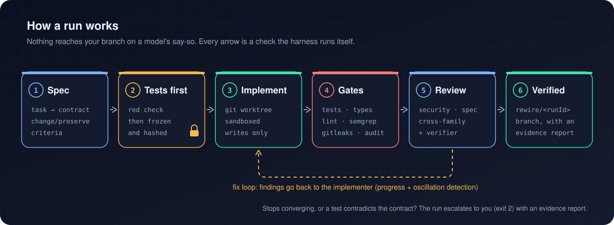

<p align="center">
  
</p>

<p align="center">
  <a href="https://www.npmjs.com/package/sheperd"></a>
  <a href="https://github.com/Abubakarjutt/sheperd/actions/workflows/ci.yml"></a>
  
  
  <a href="LICENSE"></a>
</p>

<p align="center">
  <a href="#quick-start"><b>Quick start</b></a> ·
  <a href="#how-a-run-works"><b>How it works</b></a> ·
  <a href="#choosing-models"><b>Models</b></a> ·
  <a href="#usage"><b>Usage</b></a> ·
  <a href="#known-v01-limitations"><b>Limitations</b></a>
</p>

---

You give rewire a task. It writes a contract and a set of tests **first**, freezes them, lets a
model implement against them **inside a sandbox**, then blocks the result on **hard gates** and
an **independent multi-model review** before it commits anything to a branch. It never reports
"verified" on the strength of a model's say-so.

It works with Claude, OpenAI models and local models through [Ollama](https://ollama.com).

> [!NOTE]
> **Status: v0.1 beta, TypeScript repositories only.** The 20-task anti-slop benchmark in
> [`bench/`](bench/README.md) exists and its scorer is unit-tested, but **it has not been run
> against real models yet**. There are no measured pass rates, and nothing here should be read as
> a claim about how often rewire catches slop. The release checklist
> ([`docs/v0.1-release-checklist.md`](docs/v0.1-release-checklist.md)) lists what must hold on a
> live run before v0.1 is called released.

## Why rewire

Coding agents are fast, and they are very good at producing work that _looks_ done: tests that
assert nothing, a fix that special-cases the one input in the bug report, an error swallowed so
the suite goes green, a test quietly edited until it passes. rewire is built so that none of
those can reach your branch on the model's word alone.

| The usual failure                              | What rewire does instead                                                                                                                |
| ---------------------------------------------- | --------------------------------------------------------------------------------------------------------------------------------------- |
| The agent edits the tests until they pass      | Tests are written before the code, checked red, then **frozen and hashed**. Changing one fails a gate.                                  |
| "All tests pass", but the tests assert nothing | Every test must make an assertion; the harness proves the runner enforces it with its own probe test.                                   |
| The model grades its own homework              | Reviewers and the verifier come from a **different model family** than the implementer whenever one is available.                       |
| The agent runs anything on your machine        | Every write and command goes through **`rewire-sandbox`** (bubblewrap on Linux, `sandbox-exec` on macOS), with credential files denied. |
| "Done!" with nothing to show for it            | A run is either `verified` (committed to `rewire/<runId>` with an evidence report) or escalated to you with the reason.                 |

## Quick start

**1. Install** rewire (Node.js 22 or newer) and the tools its gates use:

```sh
npm i -g sheperd                 # the package is "sheperd"; the command is "rewire"

# macOS
brew install ripgrep semgrep gitleaks

# Debian / Ubuntu (gitleaks: see "Installation in detail" below)
sudo apt-get install -y git ripgrep bubblewrap pipx && pipx install semgrep==1.186.0
```

**2. Check your setup.** Every line should be a `✓`; each `✗` comes with the fix.

```sh
rewire doctor
```

**3. Give it a model.** With nothing configured, rewire uses what it finds:

```sh
export ANTHROPIC_API_KEY=...     # → anthropic:claude-sonnet-5-5
export OPENAI_API_KEY=...        # → openai:gpt-5   (both set = cross-family review)
# or just have Ollama running with a model pulled: fully local, no key needed
```

**4. Run a task** from the root of a clean git repository:

```sh
cd my-typescript-project
rewire run "add a --json flag to the export command"
```

**5. Read the result.** A verified run (exit code `0`) is committed to the branch
`rewire/<runId>`; your current branch is never touched. The evidence report explains what was
checked and why it passed:

```sh
git log --oneline rewire/<runId>
cat .rewire/runs/<runId>/report.md
```

If the run escalates instead (exit code `2`), the same report says why and what it needs from
you. Add `.rewire/runs/`, `.rewire/worktrees/` and `.rewire/cache/` to your `.gitignore`.

## How a run works

<p align="center">
  
</p>

1. **Spec.** The task becomes a contract (asking you clarifying questions if it is ambiguous):
   acceptance criteria, non-goals and affected areas. Each criterion has a kind: `change` (new or
   corrected behaviour) or `preserve` (behaviour that works today and the task says must keep
   working, e.g. "everything else keeps working"). A contract needs at least one `change`
   criterion; one with none is retried once, then refused (`contract_without_change`), so
   refactor-only tasks (no behaviour change) are not supported in v0.1.
2. **Tests first.** A test-writer model writes at least one test per criterion, each titled with
   its criterion id, and the harness runs them against the unchanged repo (the red check):
   - a test for a `change` criterion must fail with an assertion error, as must a test with no
     criterion id; these problems get one retry;
   - a test for a `preserve` criterion must pass. One that fails stops the run at once, never
     retried (`preserve_fails_now`), and asks you whether the criterion is mislabelled (really a
     `change`) or the test is wrong. A retry could only make it pass by weakening it. The
     exception is a test that crashed in its own code rather than on an assertion (for example,
     it called a function that does not exist): that is a test-writer mistake and gets the one
     retry. An error thrown from the code under test still stops the run;
   - every test must make an assertion. The harness runs its own no-assertion probe test in the
     same run and stops (`assertion_rule_unenforced`) if the test runner does not fail it.

   The tests are then frozen and hashed. After implementation, every frozen test, of either kind,
   must pass. The report lists each criterion with its kind. What this does not catch: a bug
   labelled `preserve` whose test does not exercise the bug passes the red check; the
   spec-compliance reviewer, which sees the task text, is asked to report such a label.
3. **Implement.** An implementer model works in a git worktree. Writes happen only through a
   sandboxed helper (`rewire-sandbox`), and frozen tests cannot be edited.
4. **Gates.** Hard-block checks: tests, types, lint, semgrep, gitleaks, dependency audit, frozen
   test integrity.
5. **Review.** Up to three reviewers inspect the diff (security and spec compliance always;
   silent-failure when the added lines match its patterns) and must back each finding with
   evidence, which may quote lines the diff removed; a verifier tries to refute them. The
   spec-compliance reviewer and the verifier also get your task text (fenced as data), to check
   the contract's criterion kinds against it. Reviewer and verifier models are chosen from a different
   model family than the implementer when one is available.
6. **Fix loop.** Findings go back to the implementer, with progress and oscillation detection,
   a re-plan, and escalation to you when it stops converging.
7. **Result.** A verified run is committed to the branch `rewire/<runId>` with an evidence report.

## Usage

```sh
rewire run "add a --json flag to the export command" [--repo <path>] [--models <file>] [--headless]
rewire run --task-file task.md [--repo <path>] [--models <file>] [--headless]
```

`--repo` defaults to the current directory, which must be the root of a clean git repository
(a package subdirectory of a monorepo is refused with `not_repo_root` in v0.1).
`--headless` never asks questions (an ambiguous task escalates with reason
`clarification_required`) and writes machine-readable events to stdout and the human summary to
stderr.

### Exit codes

| code | meaning                                                                                        |
| ---- | ---------------------------------------------------------------------------------------------- |
| 0    | the run is `verified`. This is the only success.                                               |
| 1    | usage error, unsupported platform, a missing prerequisite, or an unexpected error              |
| 2    | the run escalated to a human (see the evidence report for the reason)                          |
| 130  | a second Ctrl-C: forced quit (the first Ctrl-C stops the run and writes an interrupted report) |

Running `rewire` with no arguments prints the usage and exits 1; `rewire --help` prints it and exits 0.

### Run directory

Every run writes into the target repo:

```
.rewire/runs/<runId>/
  events.jsonl   every pipeline event, redacted, in emit order
  contract.json  the contract the spec stage produced
  manifest.json  the frozen tests: paths and hashes
  report.md      the evidence report, including the known limitations below
```

Add `.rewire/runs/`, `.rewire/worktrees/` and `.rewire/cache/` to the repo's ignore file (not
all of `.rewire/`: `.rewire/policy.toml` is the repo policy and belongs in version control). The
result of a verified run lives on the branch `rewire/<runId>`.

## `rewire doctor`

```sh
rewire doctor [--models <file>]
```

Prints one line per check, `✓` or `✗` with a fix hint, and exits `0` when everything required is
present or `1` otherwise. It checks: the sandbox binary, `git`, `rg`, `semgrep`, `gitleaks`,
`bwrap` (Linux) or `sandbox-exec` (macOS), the model list, and, when any model is an Ollama model,
that Ollama is reachable and at least version 0.6.4. Run it before your first `rewire run`.

## Choosing models

With no configuration, rewire uses whatever it finds: `ANTHROPIC_API_KEY` selects
`anthropic:claude-sonnet-5-5`, `OPENAI_API_KEY` selects `openai:gpt-5`, and a reachable local
Ollama selects its first pulled model. Override the first two with `REWIRE_ANTHROPIC_MODEL` and
`REWIRE_OPENAI_MODEL`. Ollama is found at `OLLAMA_HOST` (default `http://127.0.0.1:11434`).

For control, write a `models.toml` and pass `--models <file>`, or save it as
`~/.config/rewire/models.toml` (`$XDG_CONFIG_HOME/rewire/models.toml`), which is used
automatically. Models are written `<provider>:<model>` where provider is `anthropic`, `openai` or
`ollama`.

- `available` (required): the models rewire may use. The first one is the author: it writes the
  spec and tests and implements.
- `[roles]` (optional): pin a role (`spec`, `test-writer`, `implementer`, `reviewer`, `verifier`)
  to a model. A pinned model must also be in `available`.

Unpinned, the reviewer is the first available model of a different family than the implementer,
and the verifier prefers a family different from both. The report records the resulting
**independence**: `cross-family` when reviewer and verifier both differ in family from the
implementer, otherwise `same-family`.

**Claude and GPT**, cross-family:

```toml
available = ["anthropic:claude-sonnet-5-5", "openai:gpt-5"]
```

**Claude and a local Qwen via Ollama**, cross-family, with the roles pinned:

```toml
available = ["anthropic:claude-sonnet-5-5", "ollama:qwen2.5-coder:14b"]

[roles]
implementer = "anthropic:claude-sonnet-5-5"
reviewer = "ollama:qwen2.5-coder:14b"
```

**Ollama only**, fully local and free, but `same-family`:

```toml
available = ["ollama:qwen2.5-coder:14b", "ollama:qwen2.5-coder:7b"]
```

With one model family, the reviewers and the implementer share training blind spots, so the
review is weaker than a cross-family one. Rewire still runs, and marks the evidence report
`independence: same-family` so you can discount it. Ollama models must support tool calling;
rewire checks this.

Each Ollama reply may take up to 300 seconds. A larger local model on modest hardware can need
more: set `REWIRE_OLLAMA_TIMEOUT_S` (whole seconds, 1 to 86400), e.g.
`REWIRE_OLLAMA_TIMEOUT_S=900 rewire run ...`. `rewire doctor` shows the value in use.

## Configuration

| Variable                                        | What it does                                                                              |
| ----------------------------------------------- | ----------------------------------------------------------------------------------------- |
| `ANTHROPIC_API_KEY`, `OPENAI_API_KEY`           | Enable the Anthropic and OpenAI providers (auto-detected when no `models.toml` is given). |
| `REWIRE_ANTHROPIC_MODEL`, `REWIRE_OPENAI_MODEL` | Override the auto-detected Anthropic and OpenAI models.                                   |
| `OLLAMA_HOST`                                   | Where Ollama is found (default `http://127.0.0.1:11434`).                                 |
| `REWIRE_OLLAMA_TIMEOUT_S`                       | Seconds to wait for each Ollama reply: whole seconds, 1 to 86400, default 300.            |
| `REWIRE_SANDBOX_BIN`                            | Use this sandbox binary (a missing file is an error, never a fall-through).               |
| `XDG_CONFIG_HOME`                               | Where the default `rewire/models.toml` is looked up (default `~/.config`).                |

The repository's own policy lives in `.rewire/policy.toml` and belongs in version control. Policy
layers only ever tighten: built-in, then organisation, then repository, then run.

## Installation in detail

### From npm

rewire is published to npm as the package **`sheperd`** (a v0.1 beta). The command it installs
is `rewire`:

```sh
npm i -g sheperd
rewire doctor
```

The package carries the CLI as one bundled file plus a prebuilt `rewire-sandbox` for your
platform, which npm installs automatically as an optional dependency
(`sheperd-darwin-arm64`, `sheperd-darwin-x64`, `sheperd-linux-x64` or `sheperd-linux-arm64`).
Supported platforms: macOS on Apple silicon or Intel, and Linux on x64 or arm64 with glibc 2.35
or newer (Ubuntu 22.04, Debian 12 or later; musl distributions such as Alpine are not supported).
Windows is not supported. If your npm install skips optional dependencies
(`--omit=optional`, `--no-optional`), the sandbox binary is missing and `rewire doctor` says so.

You still need these system tools on `PATH`: git,
[ripgrep](https://github.com/BurntSushi/ripgrep), [semgrep](https://semgrep.dev),
[gitleaks](https://github.com/gitleaks/gitleaks), and on Linux
[bubblewrap](https://github.com/containers/bubblewrap) 0.8 or newer. macOS uses the built-in
`sandbox-exec`. See the per-OS install commands below.

### From source

Requirements: git, Node.js 22+, pnpm, a Rust toolchain (to build the sandbox helper),
[ripgrep](https://github.com/BurntSushi/ripgrep), [semgrep](https://semgrep.dev),
[gitleaks](https://github.com/gitleaks/gitleaks), and on Linux
[bubblewrap](https://github.com/containers/bubblewrap) 0.8 or newer. macOS uses the built-in
`sandbox-exec`. Windows is not supported. CI uses semgrep 1.186.0 and gitleaks 8.30.1, the
versions the gates were developed against.

```sh
# macOS
brew install ripgrep semgrep gitleaks pnpm

# Debian/Ubuntu
sudo apt-get install -y git ripgrep bubblewrap pipx
pipx install semgrep==1.186.0
pipx ensurepath          # then restart the shell so ~/.local/bin is on PATH
# gitleaks: download the release for your platform from
#   https://github.com/gitleaks/gitleaks/releases/tag/v8.30.1
# and put the `gitleaks` binary on PATH
# pnpm: npm install -g pnpm   (or corepack enable)
```

Then build rewire from source:

```sh
git clone <this repository> rewire && cd rewire
cargo build --release -p rewire-sandbox
pnpm install --frozen-lockfile
pnpm -r build

# put the CLI on PATH (or run `node "$PWD/packages/cli/dist/main.js"` directly)
alias rewire='node '"$PWD"'/packages/cli/dist/main.js'
```

The CLI looks for the sandbox binary in this order:

1. `REWIRE_SANDBOX_BIN` (a missing file is an error, never a fall-through);
2. the newer of `target/release/` and `target/debug/` in the checkout (source builds only; the npm
   package never looks for a checkout);
3. the `sheperd-<os>-<arch>` package installed next to the CLI (only there: never via `NODE_PATH`
   or other global folders). Its binary must match the sha256 recorded in the npm bundle at
   build time; a package whose binary is missing, not executable, modified, or of a different
   version than the CLI is an error, never a fall-through;
4. the first absolute `PATH` entry that has `rewire-sandbox`.

`rewire doctor` reports exactly this lookup, including which step found the binary, and a run
that cannot find the binary stops in preflight, before any model call.

## Benchmark

```sh
pnpm bench:validate   # checks the 20 tasks and their traps, no models, free
pnpm bench            # runs the tasks against real models: costs money
```

See [`bench/README.md`](bench/README.md). **No live run has been made yet**; the release checklist
defines what a first run must show.

## Behaviour changes in this release

- Leftover processes fail the command on Linux too: a command that leaves a child running more than
  300 ms after it exits (a server a test suite never closes, slow workers) now fails as a sandbox
  escape (`sandbox_escape`), matching macOS. Test suites that relied on this passing on Linux need
  to close what they start.
- More home files are unreadable inside the sandbox: shell start-up, history and backup files
  (`~/.zshrc*`, `~/.zshenv*`, `~/.zprofile*`, `~/.bashrc*`, `~/.bash_profile*`, `~/.profile*`, the
  histories and `~/.zsh_sessions/`), `~/.claude*`, `~/.codex/`, `~/.gemini/`, `~/.mcp.json*`,
  `~/.cursor/mcp.json`, `~/.config/openai/`, `~/.ollama/id_*`, and `.env*` files outside the
  worktree. A zsh or login shell run inside the sandbox therefore does not see what those files
  set; PATH still comes from the host environment.

## Known v0.1 limitations

rewire is honest about what it does not catch yet. The full list is long and specific.

<details>
<summary><b>Show all known limitations</b></summary>

These are rendered into every evidence report (the first list) or are known gaps in the harness.

Stated in every report (this list is checked against the pipeline's `KNOWN_LIMITATIONS` by a test):

- The audit gate uses a registry network exception: on Linux it has full network access during that
  gate, because bwrap has no domain filtering; on macOS it can reach any host on tcp/443 plus DNS,
  because Seatbelt cannot filter by domain.
- Test-writer isolation from implementation bodies is prompt-level until the code index ships.
- Disputes escalate to the human; automated adjudication is deferred.
- TypeScript only: other languages are refused with pack_undetected.
- Rules cover JS/TS only (the semgrep rules and the TypeScript pack).
- Gitignored untracked files are deleted before every gate run and before the final commit (the
  report lists them), so the gates see exactly the committed tree; build output the implementer
  creates does not survive between gate runs.
- Host PATH passed through the sandbox.
- Credential read-deny is a deny-list, not an allow-list: listed secret files (ssh, cloud and
  registry credentials, shell rc, history and backup files, ~/.claude*, other agent CLIs'
  credentials and MCP configs, .env files in the worktree, the run's repo and up to three
  directories below HOME) are unreadable, but the rest of HOME, other
  repositories and system files stay readable by every stage, so a secret stored elsewhere can be
  read and sent to a model provider.
- Dependency installs are not harness-mediated in v0.1: the gates run against the dependencies
  already present (the repo's node_modules is shared into the worktree by a symlink, never
  committed); a new dependency name missing from the baseRef lockfile fails the audit gate and any
  lockfile change fails as protected, but other manifest dependency edits (changed ranges, file: or
  git+ specs, removals) pass both.
- Tests run in the same process as the code under test: implementer code imported by a frozen test
  can tamper with the assertion library or the reporter in-process; only cheap forgery is detected.
- The test runner config is owned by the harness: projects that need setupFiles, plugins, aliases or
  tsconfig paths fail closed.
- Jest support is covered by unit tests only (no real jest run in the harness test suite).
- No mutation testing or metric ratchet in v0.1.
- Linux has reduced OS-layer guarantees: the OS layer doesn't block creation on Linux; the
  protected-paths gate does (it re-checks every changed or untracked path against the implementer
  profile); a nested .git created after the sandbox starts fails the protected-paths gate and the
  gated-tree snapshot refuses it as a new gitlink, so it is never committed; case-variant spellings
  are caught by the path layer and the gates, not the OS.
- Linux escape reporting is best-effort: a command that kills the in-namespace reaper (kill -9 -1,
  which ends the exec with 137) or ptraces it (Yama ptrace_scope 0) avoids the escape label; the
  leftover is still killed when the pid namespace is torn down.
- On macOS, a process that detaches from the sandbox faster than one poll interval can outlive its
  stage; a worktree change it makes after the last gate run fails the final tree-equality check, but
  the process itself may keep running.
- Fake-verification residuals: the red check and the tests gate do not detect every vacuous test (a
  snapshot alias, a hand-thrown AssertionError; the tests gate also accepts a test with no expect
  call, which the red check rejects); a preserve criterion's test passes before and after the
  change, so it is only as strong as what it asserts: a bug the spec stage labels preserve stops
  the run only if its test exercises the bug, otherwise only the spec-compliance reviewer (which
  compares the labels with the task) or a human reading the report can catch it; mutation testing
  is deferred.
- The console-summary cross-check reads the last summary in the runner output, so in-process code
  that prints a forged summary after the real one is not detected.
- `__mocks__` directories are protected config: mocks cannot be added or changed during a run.
- Only npm, pnpm and yarn are recognised (bun and others fall back to npm), and the lint fallback
  runs a local binary named like the npx command.
- Changed native addons (.node) or WebAssembly (.wasm) files execute in the test gate without being
  scanned by semgrep.
- The dependency audit's new-dependency check is by name only: declared ranges, npm aliases
  (npm:<pkg>) and overrides are not checked.
- When the reviewers share the implementer's model family, the report also says
  `independence: same-family`.

Also known:

- The benchmark has not been run against real models; the scorer and traps are validated only
  with the faux provider and by construction (the hidden tests catch every slop patch).
- The benchmark's trap checks are pattern-based and have documented false-positive and
  false-negative edges (for example SQL placeholder detection).
- gitleaks' default allowlist skips some file types (svg, pdf, go.sum).
- The review's diff summary shares one 60 s git budget and depends on `/usr/bin/od`.
- Linux sandboxing needs unprivileged user namespaces; some distributions and containers
  restrict them, in which case `rewire doctor` and runs will fail. macOS and Linux are the only
  supported platforms.
- Linux: the sandbox finds `bwrap` only in `/usr/bin` or `/usr/local/bin` and does not check who
  owns it; a symlink in the repo that matches a write-deny glob makes every Linux exec fail closed
  (exit 120).
- macOS: the OS layer does not fold Unicode default-ignorable code points the way the path layer
  does, and a deny directory that is already a symlink when the run starts is writable through
  the link (the frozen-tests gate hashes resolved contents, so tests stay protected).
- A command that itself exits 3, 120, 124 or 127 is indistinguishable from a sandbox deny,
  internal error, timeout or missing binary: it fails closed, possibly with a misleading message.
- The descendant sweep after an exec has narrow races (a process that re-parents during the
  sweep, survivors at the kill bound); see the macOS detach limitation above. A failed `kill()`
  is reported as `sandbox_unavailable` (fail-closed).
- `rewire-sandbox fs-read` decodes files as UTF-8; exec output is capped at 16 MiB per stream.
  `~` is expanded only in the credential read-deny globs.
- Policy command rules are advisory (the sandbox is the enforcement boundary): their tokenizer
  does not expand `$VAR` or globs, and an empty pattern matches every command. The bash
  pre-check over-refuses some valid shell (ANSI-C quoting, comments, heredocs, `${x:-(none)}`).
- Tools do not observe the run's abort signal; each bash call is bounded by its timeout (at most
  600 s).
- `ChatRequest.timeoutMs` is honoured by the Ollama provider only; Anthropic and OpenAI use their
  SDK default timeouts. The providers' live request shapes (including tool calls) are checked by
  the release checklist's live smoke run, not by CI.
- The Ollama role-fitness cache is not safe for concurrent runs (single-user CLI), and each
  fitness probe costs a few model calls the first time a model digest is seen.
- `events.jsonl` has no size cap.
- An unexpected (non-`RewireError`) failure inside a stage exits 1 and keeps the worktree.
- A coverage failure in the test-writer stage (a criterion without a test) escalates without a
  retry.
- Non-test files that import vitest or jest are not flagged.
- Repositories that track `node_modules` always escalate (the final commit's index guard
  refuses it); the CLI prints a hint.
- The registry-client e2e test has flaked under load on a developer machine.
- No PR delivery, TUI, Python pack, plugin API or streaming in v0.1.

</details>

## Development

```sh
cargo test --workspace
pnpm -r build && pnpm -r test
pnpm biome check .
```

CI runs exactly these on Ubuntu and macOS. A nightly workflow runs `pnpm bench` and needs the
repository secrets `ANTHROPIC_API_KEY` and `OPENAI_API_KEY`; it is never triggered by pushes or
pull requests.

Design notes: [`docs/DESIGN-DECISIONS.md`](docs/DESIGN-DECISIONS.md). Licensed under Apache-2.0.
