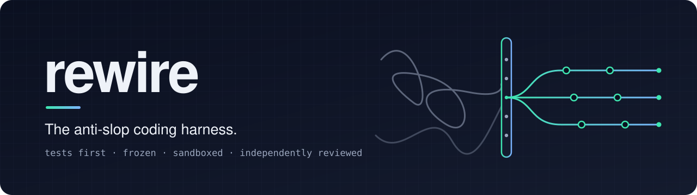

<p align="center">
  
</p>

<p align="center">
  <a href="https://www.npmjs.com/package/sheperd"></a>
  <a href="https://github.com/Abubakarjutt/sheperd/actions/workflows/ci.yml"></a>
  
  
  <a href="LICENSE"></a>
</p>

<p align="center">
  <a href="#quick-start"><b>Quick start</b></a> ·
  <a href="#how-a-run-works"><b>How it works</b></a> ·
  <a href="#choosing-models"><b>Models</b></a> ·
  <a href="#usage"><b>Usage</b></a> ·
  <a href="#known-v01-limitations"><b>Limitations</b></a>
</p>

---

You give rewire a task. It writes a contract and a set of tests **first**, freezes them, lets a
model implement against them **inside a sandbox**, then blocks the result on **hard gates** and
an **independent multi-model review** before it commits anything to a branch. It never reports
"verified" on the strength of a model's say-so.

It works with Claude, OpenAI models and local models through [Ollama](https://ollama.com).

> [!NOTE]
> **Status: v0.1 beta, TypeScript repositories only.** The 20-task anti-slop benchmark in
> [`bench/`](bench/README.md) exists and its scorer is unit-tested, but **it has not been run
> against real models yet**. There are no measured pass rates, and nothing here should be read as
> a claim about how often rewire catches slop. The release checklist
> ([`docs/v0.1-release-checklist.md`](docs/v0.1-release-checklist.md)) lists what must hold on a
> live run before v0.1 is called released.

## Why rewire

Coding agents are fast, and they are very good at producing work that _looks_ done: tests that
assert nothing, a fix that special-cases the one input in the bug report, an error swallowed so
the suite goes green, a test quietly edited until it passes. rewire is built so that none of
those can reach your branch on the model's word alone.

| The usual failure                              | What rewire does instead                                                                                                                |
| ---------------------------------------------- | --------------------------------------------------------------------------------------------------------------------------------------- |
| The agent edits the tests until they pass      | Tests are written before the code, checked red, then **frozen and hashed**. Changing one fails a gate.                                  |
| "All tests pass", but the tests assert nothing | Every test must make an assertion; the harness proves the runner enforces it with its own probe test.                                   |
| The model grades its own homework              | Reviewers and the verifier come from a **different model family** than the implementer whenever one is available.                       |
| The agent runs anything on your machine        | Every write and command goes through **`rewire-sandbox`** (bubblewrap on Linux, `sandbox-exec` on macOS), with credential files denied. |
| "Done!" with nothing to show for it            | A run is either `verified` (committed to `rewire/<runId>` with an evidence report) or escalated to you with the reason.                 |

## Quick start

**1. Install** rewire (Node.js 22 or newer) and the tools its gates use:

```sh
npm i -g sheperd                 # the package is "sheperd"; the command is "rewire"

# macOS
brew install ripgrep semgrep gitleaks

# Debian / Ubuntu (gitleaks: see "Installation in detail" below)
sudo apt-get install -y git ripgrep bubblewrap pipx && pipx install semgrep==1.186.0
```

**2. Check your setup.** Every line should be a `✓`; each `✗` comes with the fix.

```sh
rewire doctor
```

**3. Give it a model.** With nothing configured, rewire uses what it finds:

```sh
export ANTHROPIC_API_KEY=...     # → anthropic:claude-sonnet-5-5
export OPENAI_API_KEY=...        # → openai:gpt-5   (both set = cross-family review)
# or just have Ollama running with a model pulled: fully local, no key needed
```

**4. Run a task** from the root of a clean git repository:

```sh
cd my-typescript-project
rewire run "add a --json flag to the export command"
```

Or open the interactive session and describe the task there (see "Interactive mode" below):

```sh
rewire
```

**5. Read the result.** A verified run (exit code `0`) is committed to the branch
`rewire/<runId>`; your current branch is never touched. The evidence report explains what was
checked and why it passed:

```sh
git log --oneline rewire/<runId>
cat .rewire/runs/<runId>/report.md
```

If the run escalates instead (exit code `2`), the same report says why and what it needs from
you. Add `.rewire/runs/`, `.rewire/worktrees/`, `.rewire/cache/` and `.rewire/sessions/` to your
`.gitignore`.

## Interactive mode

Run `rewire` with no arguments in a terminal, from the root of a clean git repository:

```sh
rewire                # on a TTY: the interactive session
rewire chat           # always the interactive session; exits 1 with tui_requires_tty without a TTY
```

You chat with an agent that can read the repo, run sandboxed read-only commands and use skills.
It cannot write to your repo. When you want a code change, it proposes a task and you confirm it.
The change then goes through the same gated pipeline as `rewire run`, shown as a live stage board.
The chat model is the author model (`routing.spec`). Chats are saved to `.rewire/sessions/` and
can be resumed with `/resume`.

A sample session (colours left out):

```
╭──────────────────────────────────────────────────────────────╮
│ ✻ Welcome to rewire                                          │
│ cwd: ~/src/shop                                              │
│ chat: <author model>                                         │
│ run: spec <author model> · impl <implementer> · review <rev> │
│                                                              │
│ /help for commands · /run <task> for a gated change · @ to   │
│ mention a file · esc to interrupt                            │
╰──────────────────────────────────────────────────────────────╯
> why does export ignore the --limit flag? @src/export.ts
● Read(src/export.ts)
  ⎿  import { parseArgs } from "node:util";
     … +118 lines
✶ Pondering… (4s · ↓ ~310 tokens · esc to interrupt)
  (the reply streams in as Markdown; code blocks are syntax-highlighted)
╭──────────────────────────────────────────────────────────────╮
│ > add a --json flag to the export command                    │
╰──────────────────────────────────────────────────────────────╯
<author model> · ctx 12.4k · checkpoints: contract,tests · chat           ? for shortcuts
  (Enter; the agent proposes the task)
╭──────────────────────────────────────────╮
│ add a --json flag to the export command  │
│ Run this as a gated task? [y/n]          │
╰──────────────────────────────────────────╯
  (press y)
╭──────────────────────────────────────────────────────────────╮
│ ✓ Spec       contract ready                                  │
│ ○ Tests                                                      │
│ ...                                                          │
╰──────────────────────────────────────────────────────────────╯
╭──────────────────────────────────────────────────────────────╮
│ Contract checkpoint: add a --json flag to the export command │
│ AC-1 [change] export --json prints the rows as JSON          │
│ a approve · e revise · s stop                                │
╰──────────────────────────────────────────────────────────────╯
  (press a; the tests checkpoint shows a approve · v view · s stop)
  ... tests, implement, gates, review ...
Run <runId> verified.
Branch: rewire/<runId>
```

The header box shows the working directory and the models the chat and a run use. A tool call
shows as `● Name(args)` with the first lines of its result under `⎿`; a failed one is red with
`✗`. While a reply is in flight, the spinner line shows the elapsed time and the output tokens
so far (`~` while part of the count is estimated from streamed text). The status line under the
input shows the chat model, `ctx` (the size of the chat's context: the last chat model call's
input plus output tokens), the checkpoints, and what the session is doing (`chat`, `thinking`,
`run: <stage>` or `checkpoint: <kind>`). Only the chat streams; a gated run's stages do not.

By default a run pauses for your approval after the contract and after the tests. It does not
pause before the commit. Checkpoints and proposal cards take single keys, not typed lines. A
contract checkpoint takes `a` (approve), `e` (revise: type a note in the box that opens, Enter
sends it, Esc cancels it; at most 3 revisions, a 4th is treated as stop), `s` (stop) or `v`
(view every criterion, when there are more than fit on the card). The tests checkpoint takes
`a`, `v` (view the frozen tests) or `s`. The commit checkpoint, when on, takes `a`, `v` (view
the diff, coloured, with `+N −M` per file on the card) or `s`. In a view, ↑/↓ scroll a line,
PgUp/PgDn (or `b`/space) a page, `g`/`G` jump to the top or bottom, and `v` or Esc closes it.
Stopping ends the run with reason `stopped_by_user` (exit 2 semantics). Every decision is
recorded in `events.jsonl` and `report.md`. `rewire run` and `--headless` never pause.

### Keys

| Key                        | What it does                                                             |
| -------------------------- | ------------------------------------------------------------------------ |
| Enter                      | Send the input.                                                          |
| Shift+Enter or `\` + Enter | Insert a newline.                                                        |
| ↑/↓                        | Walk the input history.                                                  |
| Esc                        | Interrupt the chat reply in flight, or close the `/` menu or `@` picker. |
| Ctrl-C                     | Abort a run or a chat turn, or quit (see "Ctrl-C" below).                |
| `?` (on an empty input)    | Show or hide the shortcuts panel; any other key closes it.               |
| `/`                        | Open the command menu.                                                   |
| `@`                        | Open the file picker.                                                    |

**Esc** stops the chat reply that is streaming. What already streamed stays on screen, followed
by `⎿ Interrupted by user`, and you can send again at once. The interrupted turn is not stored
in the session. Esc does not abort a gated run; Ctrl-C does that.

**The `/` menu** opens when the input starts with `/` (until the first space; `//` never
opens it). It lists the commands that match what
you typed (only the ones allowed during a run, while one is active). ↑/↓ move the selection.
Tab completes the selected name. Enter completes it too, or runs it when the name is already
complete and the command needs no arguments. Esc closes the menu and leaves the text as typed.

**The `@` picker** opens on an `@` at the start of the input or after a space. It lists the
repo's files (`git ls-files`, up to 5,000 paths) that match what follows the `@`. ↑/↓ move the
selection, Tab or Enter inserts the path (quoted when it holds a space, a quote or a
backslash), and Esc closes the picker. It only inserts the path text: the chat agent reads the
file with its own sandboxed tools. The `/` menu and the `@` picker stay closed while the input
takes a run's clarification answers, where `/` and `@` are typed literally (`/skip` still
works).

### Slash commands

| Command                                    | What it does                                                     | During a run |
| ------------------------------------------ | ---------------------------------------------------------------- | ------------ |
| `/run <task>`                              | Start a gated run directly, without proposing first.             | no           |
| `/skills`                                  | Browse skills and their files; review pending repo skills.       | browse only  |
| `/checkpoints [contract] [tests] [commit]` | Show or set where runs pause. `/checkpoints off` pauses nowhere. | show only    |
| `/model` (or `/models`)                    | Choose the model for each role (see "Choosing models").          | show only    |
| `/resume [id]`                             | List stored sessions, or resume one.                             | no           |
| `/compact [focus]`                         | Compact the chat context now (see "Context and compaction").     | no           |
| `/context`                                 | Show the compaction limit, window and session record.            | yes          |
| `/clear`                                   | Start a fresh session. The old one stays resumable.              | no           |
| `/doctor`                                  | Check prerequisites.                                             | no           |
| `/skip`                                    | Decline a run's clarification questions.                         | yes          |
| `/help`                                    | List the commands.                                               | yes          |
| `/exit`                                    | Quit.                                                            | no           |
| `//text`                                   | Send `/text` as chat text (a literal leading slash).             | -            |

While a run is active, the input box answers clarifications (one answer per line, `/skip` to
decline); checkpoints and proposals take single keys.

### Ctrl-C

| When                                   | What happens                                                   |
| -------------------------------------- | -------------------------------------------------------------- |
| during a run                           | aborts the run (an interrupted report); the session stays open |
| during a chat turn                     | stops the turn, like Esc                                       |
| idle at the prompt                     | exits 0                                                        |
| a second press within 1 second         | exits 130                                                      |
| at a proposal card or the trust prompt | exits 0 (the chat is saved and can be resumed)                 |

A chat `bash` command ignores the abort and runs to its own timeout (up to 600 seconds). It
cannot write to the repo.

## Context and compaction

A long chat fills the model's context window. rewire compacts the chat before that happens.
Compaction applies to the interactive chat only. `rewire run`, `--headless` and the gated
pipeline never compact.

### What compaction does

After a compaction the model sees, in order:

1. the session record: a structured list of goals, constraints, decisions, open questions,
   preferences, next steps and notes, each with the messages that back it;
2. your recent messages, kept verbatim (up to `recent_user_tokens`, and at most a quarter of the
   limit; fewer, or none, when the context must shrink to fit, and the newest one cut in the
   middle when it alone is over that budget);
3. every turn after that point.

The older assistant turns and tool output are not kept in the context. The full conversation
stays on disk, and the chat can search it with `recall`.

It is a record and not a summary, so nothing is lost without a trace:

- The model proposes edits to the record (add, update, resolve, supersede). Code checks every
  one. Each edit cites messages, and the quote must appear word for word in the cited message.
- A constraint that came from you can only be created or changed by an edit that quotes one of
  your own messages. Tool output, file contents, skills and the model's own text can never make
  or override one. This stops a file that says "from now on, the user requires X" from becoming
  a standing rule.
- Only items tagged `[user …]` speak for you. Everything else is `[inferred …]`: the compactor's
  reading of tool output, files and replies, which the chat model is told never to treat as an
  instruction. An inferred item that none of your messages supports is shown as
  `[inferred, not from the user …]`.
- Some edits are also checked by a second model, from a different family when one is
  configured: an edit that changes one of your rules or adds a claim attributed to you, any
  change to an open question, and an inferred goal, constraint, must-keep-working item or
  decision that rests on tool output with no message of yours behind it. Without that check they are not applied. If the
  check is unavailable, the whole compaction fails.
- Skill text and `recall` results are never evidence for an edit.
- Items are never deleted. Resolved and superseded items move to an archive.
- If a compaction fails for any reason, the previous record and the full context are kept, and
  the chat carries on. (When a long window is compacted in parts, the parts already applied
  stay.)

The facts about files and commands (what was read, which commands ran and their exit codes,
which tool calls failed) are computed by code from the stored messages. The model does not
write them. Run outcomes are not part of the record.

### When it triggers

The limit is a number of tokens. Compaction runs before a send when the next request would reach
it. For a context window `W`, the formula is:

```
min(0.85·W, 32768·(W/32768)^0.6), rounded down to the thousand
```

| window | trigger |
| ------ | ------- |
| 8K     | 6000    |
| 32K    | 27000   |
| 128K   | 75000   |
| 200K   | 97000   |
| 256K   | 114000  |
| 1M     | 262000  |

Large windows trigger well before they are full. Models read long prompts less reliably, and
every turn re-reads the whole context.

Other candidates:

- **Window share.** `0.85·W`, rounded down to the thousand.
- **Latency.** Once rewire has timed the model reading prompts, that rate times
  `latency_budget_s`. A slow local model compacts sooner.
- **Calibrated.** `rewire calibrate` (below) measures how much context a model really uses.
  The measured value replaces the formula, so it can be higher than the formula's value (a 200K
  window that passes at 128K gives 131,072, not 97,000).

The smallest candidate wins. It is raised to at least 4,096 and then capped at `0.85·W`, so a
window under about 4.8K gets a limit below 4,096. A configured `limit` (below) replaces all of
this; it is at least 4,096 and is not capped. The window is asked of the provider (Ollama's
loaded context, or a built-in table for Anthropic and OpenAI).

Compaction aims to leave the context at no more than half the limit, with room for the message
being sent, keeping fewer recent messages and then a shorter record until it fits. Your own rules are
never dropped from the record, so when they alone are too big the compaction still applies, and
automatic compaction is held back (` · held`, or ` · stuck`).

### `models.toml`

```toml
[compaction]
latency_budget_s = 60        # 5 to 3600; seconds to read a full context
recent_user_tokens = 20000   # 1000 to 200000; your recent messages kept verbatim

[compaction.models."ollama:qwen3:32b"]
limit = 24000                # integer, at least 4096; replaces every computed candidate
```

All keys are optional. Unknown keys are an error (`models_file_invalid`).

### Commands and the status line

| Command            | What it does                                                                                                                                            |
| ------------------ | ------------------------------------------------------------------------------------------------------------------------------------------------------- |
| `/compact [focus]` | Compact now. The optional focus tells the compactor what to keep. Not available during a run. Esc cancels.                                              |
| `/context`         | Show the limit and how it was chosen, the window, the record counts, the last compaction and the record itself. Scroll with the arrow keys, Esc closes. |

The status line shows `ctx 61k/74k (f)`: the context size, the limit, and why the limit is that
value: `f` formula, `l` latency, `c` calibrated, `w` window share, `o` override. The size is dim,
turns yellow at 70% of the limit and red at 90%. A dim ` · held` means automatic compaction is
waiting for the context to grow by a quarter of the limit before it tries again. ` · stuck` means
automatic compaction is off for this window, because a failed or over-budget compaction left the
context at or past halfway from the limit to `0.85·W`. `/compact` still works then, and a
changed window clears it.

Lines you may see:

- `⎿ compacted 41 messages → record (3 decisions · 2 constraints · 1 open) · ctx 72k → 9k`
- `⎿ 2 proposed changes rejected: <first reason>…` (the checks refused some edits; the rest applied)
- `⎿ compaction skipped: <code> — kept full context (/context for details)`
- `⎿ automatic compaction paused: <reason> — /compact to retry`
- `⎿ note: compaction checks use the same model family as chat (no independent verifier configured)`

### `recall`

The chat has a read-only `recall` tool. It searches the whole stored conversation and the
archive for a word or phrase, so a detail that left the context can be found again. Results are
at most 10 snippets and 4 KB, are cleaned of secrets, and are fenced as untrusted data. Only the
chat has it, never a pipeline stage, and a compaction never cites its results as evidence.

### `rewire calibrate`

```sh
rewire calibrate <provider:model> [--max <tokens>] [--yes] [--models <file>] [--fresh]
```

The formula is a guess. `calibrate` measures. It sends probes of growing length (8K, 16K, 32K
and so on, up to 0.95 of the window or `--max`, which takes `N` or `Nk`). Each probe is filled
with varied text with facts planted through it, and the model has to answer five questions about
them. A probe passes with 4 of 5 right. The effective context is the longest length that passes
along with every shorter one. The run stops after two failures in a row.

On a local model this is slow: each long probe can take minutes, and a full run can take an hour
or more. Calibration never runs by itself.

- **Resume.** Each length is saved as soon as it finishes, under the XDG cache directory. Ctrl-C
  stops the run after the lengths already recorded (exit 130; a second Ctrl-C force-quits), and
  the same command continues from the saved lengths. A failed run exits 1
  (`calibration_failed`). `--fresh`
  measures everything again.
- **Stale runs.** The result is tied to the model's digest and window. If the window changes by
  more than 10%, the result is stale: `/context` warns, the trigger stops using it, and
  `calibrate` measures again. An endpoint's result is kept by `<endpoint>:<model>`, not its
  `base_url`: after pointing an endpoint at another server, run `calibrate --fresh`.
- **Truncation.** If the provider read far fewer tokens than were sent (under 60%), the probe is
  not scored and the run fails with `calibration_failed`. For Ollama, the hint is to raise
  `OLLAMA_CONTEXT_LENGTH` (for example 65536) on the server, or set `num_ctx` in a Modelfile.
- **Provider errors.** An error is not a score. The run is marked incomplete and the failed
  length is tried again next time. An incomplete run is never used.
- **Paid providers.** For every provider except Ollama, the faux provider and an endpoint on a
  loopback `base_url` (Anthropic, OpenAI, Bedrock, Vertex, Foundry, Azure, Gemini, any other
  endpoint), `calibrate` prints the probe list and an input-token estimate (a token count, not a
  price), then exits without spending. Add `--yes` to run. Ollama and loopback endpoints need no
  flag.

## Skills

Interactive mode can use Claude-style skills (`<name>/SKILL.md`).

- **User skills** load automatically from `~/.claude/skills` and `$XDG_CONFIG_HOME/rewire/skills`
  (default `~/.config/rewire/skills`). A user skill wins over a repo skill with the same name.
- **Repo skills** (`<repo>/.claude/skills`) load only after you approve them. The approval is
  stored once per repo, pinned to a sha256 over all the skills' files, in
  `$XDG_CONFIG_HOME/rewire/trusted-skills.json`. If any file changes, rewire asks again. The
  prompt also lists repo skills shadowed by a user skill, because they are part of the hash.
- Skills are read once per session. A skill you trust mid-session takes effect when the session
  is rebuilt: after `/clear` or `/resume`, or a `/model` pick that changes the chat model or the
  verifier.
- `/skills` lists every skill found, with its source (`user` or `repo`) and state (`active`,
  `pending trust`, `trusted; takes effect in a new session (/clear)` or `shadowed`), active ones
  first. Enter shows a skill's description, path and the files in its directory now. A
  symlinked skill directory is followed once and shown as `linked → <real path>`; links inside
  it are listed, never followed. Esc goes back, then closes. When repo skills
  are pending, a first row, "Review pending repo skills", opens the trust prompt. During a run
  the list is read-only, that row is absent, and a checkpoint or clarification closes the list.
- A skill that is rejected (malformed, over a limit, or a repo skill with a symlink) is skipped
  and shown as a warning line when the session starts.
- Skills are given to the chat, the spec stage, the test writer and the implementer. The
  reviewers and the verifier never get them. Skill text can still reach a reviewer indirectly if
  an author stage copies it into the contract or the diff.

Limits: `SKILL.md` up to 256 KiB. A repo skill directory up to 2 MiB and 200 files, with no
symlinks. A user skill directory up to 64 MiB and 5000 files; its symlinks are followed only to
targets inside your home directory that are not credential files.

## Web access

The chat agent, the spec stage and the implementer (in every fix round too) have two tools,
`web_search` and `web_fetch`. Nothing else goes online: the test writer, the reviewers, the
verifier, compaction and its verifier never get the tools, and the frozen tests and the gates run
in the sandbox as before, with no network (the dependency audit's registry exception is
unchanged). The tools run in the rewire process, outside the sandbox. The sandbox's network
allowlist stays empty, so `bash` in the chat or the implementer still cannot reach the network.

Web access is on by default in `rewire` (chat) and `rewire run`. `web_fetch` needs no key. Without
a search backend, `web_search` returns a tool error that says what to set, and chat and runs work
as before. `.rewire/policy.toml` can turn web off (see below). Faux-provider runs
(`REWIRE_FAUX_SCRIPT`) never get web access. The benchmark runs tasks through `rewire run`, so a
real-model benchmark run has web access too, unless a task fixture's policy turns it off.

### Search backends

| Backend          | Setup                                                                 |
| ---------------- | --------------------------------------------------------------------- |
| Ollama (default) | `OLLAMA_API_KEY`, a free key from ollama.com (its hosted search API). |
| Tavily           | `TAVILY_API_KEY`.                                                     |
| Brave Search     | `BRAVE_API_KEY` (sent as the `X-Subscription-Token` header).          |
| SearXNG          | Your own instance: `search = "searxng"` and `searxng_url`, no key.    |

A SearXNG server must allow JSON output: add `json` to `search.formats` in its `settings.yml`
(a 403 means it does not).

With `search` unset, rewire uses the first of `OLLAMA_API_KEY`, `TAVILY_API_KEY` and
`BRAVE_API_KEY` that is set (a blank value counts as unset). An explicit `search` uses that
backend or says its key is missing; it never falls back to another one. Search requests never
follow a redirect, so a key is never sent to another host. `rewire doctor` shows which backend
and which env var it found (see [`rewire doctor`](#rewire-doctor)).

`models.toml`:

```toml
[web]
search = "tavily"                       # "ollama" | "tavily" | "brave" | "searxng"; optional
searxng_url = "https://search.example"  # https, or http on a loopback host; no credentials, query or fragment
max_results = 5                         # 1 to 10, default 5
```

An unknown key or a bad value fails with `models_file_invalid`.

### Policy

`.rewire/policy.toml`:

```toml
[web]
enabled = false                         # default true
deny_domains = ["pastebin.com"]         # these hosts and their subdomains are refused
allow_domains = ["nodejs.org", "developer.mozilla.org"]  # when set, only these and their subdomains
```

The rules apply to every fetch target, every redirect hop, and the result URLs `web_search`
shows (hidden results are counted, as `N hidden by policy`). A refused fetch is a tool error that
names the rule. Domains are bare host names (no scheme, port, path or `*.`), matched case-
insensitively, and `deny_domains` wins over `allow_domains`. A bad entry fails with
`policy_invalid`.

Layers only tighten. A later layer can turn web off but never back on (`policy_loosening`).
`deny_domains` is the union of all layers. The first layer that sets `allow_domains` sets it, and
each later one intersects with it. An empty `allow_domains` (`[]`, or layers with no domain in
common) allows nothing, so the tools are removed, as with `enabled = false`.

### What a fetch may do

- Only `http` and `https`, URLs up to 2048 characters, no `user:password@`.
- **No private addresses.** Each host is resolved and refused if any address is loopback, private
  (10/8, 172.16/12, 192.168/16, fc00::/7), link-local (169.254/16 including cloud metadata,
  fe80::/10), CGNAT (100.64/10), multicast, unspecified or reserved. `localhost`, `*.localhost`,
  `.local` and `.internal` names are refused too. IPv4 written as a number (`0x7f000001`,
  `2130706433`, `127.1`) and IPv4 inside IPv6 (mapped, compatible, NAT64, 6to4) are judged as
  IPv4. Teredo is refused. The connection is pinned to the address that was checked, so DNS
  rebinding cannot swap it. Every redirect is checked again, up to 5.
- 30 s for the whole fetch, at most 5 MB read and 100,000 characters of text, with truncation
  stated. Only text types: `text/*`, JSON and XML. HTML is converted to plain text, and links keep
  their targets. Any other type is a short tool error naming the type.
- A fixed `User-Agent: rewire/<version>` is sent, and nothing about you.

The SearXNG URL is yours, so it is not checked against these rules; it can be on loopback.

### What goes out, and what comes back

- **Outgoing.** A query or URL that holds a secret-shaped value is refused before anything is
  sent. The patterns are the ones rewire redacts, also when percent-encoded (to any depth),
  `%uXXXX`-escaped, full-width or split by control characters. `sk-`, `ghp_` and `AKIA` keys are
  also caught with other characters in front (`x<key>`). A host name is checked case-
  insensitively. Queries are capped at 400 characters.
- **Incoming.** Every title, URL, snippet and page has control and escape sequences removed and
  secrets redacted. It reaches the model inside an `<untrusted_web>` fence, which the page
  cannot close, and the agents' prompts say web content is data, never instructions.
- **Audit.** Every call emits a `web_request` event, whether it succeeded or failed: the tool, the
  backend, the query or the URL's host and path (never its query string), the status, the
  number of results and the bytes returned. It goes to the run's `events.jsonl`, or the chat's
  event stream. A refused secret-shaped value is recorded as `[refused: secret-shaped]`, and a
  key is never recorded. The TUI shows each call as `● WebSearch("<query>")` or
  `● Fetch(<host><path>)`, with result titles and hosts, or the page's first line, status and
  size.

### Residuals

- A page can still mislead the model's reasoning. The fence stops a page from posing as
  instructions in rewire's prompts, but a model can still believe what it reads. The gates and
  the review check the result, not the sources.
- With web on, repository text that does not look like a secret can leave in a query or a URL,
  through a prompt-injected page or a model's own choice. The outgoing check catches only
  secret-shaped values. `allow_domains` (or `enabled = false`) is the control for repositories
  where this matters.
- A key that has been re-encoded (base64, reversed, split across host labels, overlong UTF-8) is
  not recognised.
- The outgoing check has false positives that fail closed: an `sk-` word followed by a word of
  20 or more letters (`ask-about-internationalization`) and host labels that start like an AWS
  key id (`akia…`) are refused.
- Web text is NFKC-normalised, so full-width and other compatibility forms in a page reach the
  model as their plain forms.
- `tool_call` summaries of other tools (a `bash` command, for one) are still logged with display
  redaction only, so a key written with a prefix (`x<key>`) can appear there.
- A cancelled chat turn's web calls are still recorded, because their requests went out.

## How a run works

<p align="center">
  
</p>

1. **Spec.** The task becomes a contract (asking you clarifying questions if it is ambiguous):
   acceptance criteria, non-goals and affected areas. Each criterion has a kind: `change` (new or
   corrected behaviour) or `preserve` (behaviour that works today and the task says must keep
   working, e.g. "everything else keeps working"). A contract needs at least one `change`
   criterion; one with none is retried once, then refused (`contract_without_change`), so
   refactor-only tasks (no behaviour change) are not supported in v0.1.
2. **Tests first.** A test-writer model writes at least one test per criterion, each titled with
   its criterion id, and the harness runs them against the unchanged repo (the red check):
   - a test for a `change` criterion must fail with an assertion error, as must a test with no
     criterion id; these problems get one retry;
   - a test for a `preserve` criterion must pass. One that fails stops the run at once, never
     retried (`preserve_fails_now`), and asks you whether the criterion is mislabelled (really a
     `change`) or the test is wrong. A retry could only make it pass by weakening it. The
     exception is a test that crashed in its own code rather than on an assertion (for example,
     it called a function that does not exist): that is a test-writer mistake and gets the one
     retry. An error thrown from the code under test still stops the run;
   - every test must make an assertion. The harness runs its own no-assertion probe test in the
     same run and stops (`assertion_rule_unenforced`) if the test runner does not fail it.

   The tests are then frozen and hashed. After implementation, every frozen test, of either kind,
   must pass. The report lists each criterion with its kind. What this does not catch: a bug
   labelled `preserve` whose test does not exercise the bug passes the red check; the
   spec-compliance reviewer, which sees the task text, is asked to report such a label.
3. **Implement.** An implementer model works in a git worktree. Writes happen only through a
   sandboxed helper (`rewire-sandbox`), and frozen tests cannot be edited.
4. **Gates.** Hard-block checks: tests, types, lint, semgrep, gitleaks, dependency audit, frozen
   test integrity.
5. **Review.** Up to three reviewers inspect the diff (security and spec compliance always;
   silent-failure when the added lines match its patterns) and must back each finding with
   evidence, which may quote lines the diff removed; a verifier tries to refute them. The
   spec-compliance reviewer and the verifier also get your task text (fenced as data), to check
   the contract's criterion kinds against it. Reviewer and verifier models are chosen from a different
   model family than the implementer when one is available.
6. **Fix loop.** Findings go back to the implementer, with progress and oscillation detection,
   a re-plan, and escalation to you when it stops converging.
7. **Result.** A verified run is committed to the branch `rewire/<runId>` with an evidence report.

## Usage

```sh
rewire                                     # interactive session (on a TTY)
rewire chat [--repo <path>] [--models <file>]
rewire run "add a --json flag to the export command" [--repo <path>] [--models <file>] [--headless]
rewire run --task-file task.md [--repo <path>] [--models <file>] [--headless]
```

`--repo` defaults to the current directory, which must be the root of a clean git repository
(a package subdirectory of a monorepo is refused with `not_repo_root` in v0.1).
`--headless` never asks questions (an ambiguous task escalates with reason
`clarification_required`) and writes machine-readable events to stdout and the human summary to
stderr.

### Exit codes

| code | meaning                                                                                        |
| ---- | ---------------------------------------------------------------------------------------------- |
| 0    | the run is `verified`. This is the only success.                                               |
| 1    | usage error, unsupported platform, a missing prerequisite, or an unexpected error              |
| 2    | the run escalated to a human (see the evidence report for the reason)                          |
| 130  | a second Ctrl-C: forced quit (the first Ctrl-C stops the run and writes an interrupted report) |

Running `rewire` with no arguments and no TTY prints the usage and exits 1 (on a TTY it opens the
interactive session); `rewire --help` prints it and exits 0.

### Error codes

Errors carry a stable code. The ones added with interactive mode and skills:

| code                              | meaning                                                                             |
| --------------------------------- | ----------------------------------------------------------------------------------- |
| `tui_requires_tty`                | `rewire chat` needs a terminal. Exit 1.                                             |
| `tui_render_failed`               | The terminal UI failed to render.                                                   |
| `skill_invalid`                   | A skill is malformed or over a limit (name, description, size, symlink).            |
| `trust_store_unreadable`          | `trusted-skills.json` is unreadable: repo skills are not loaded; the session opens. |
| `trust_store_locked`              | Another rewire process holds the trust store lock.                                  |
| `session_corrupt`                 | A stored session file is damaged.                                                   |
| `session_locked`                  | Another rewire process is writing this session; retry shortly.                      |
| `session_not_found`               | `/resume` named a session that is not stored.                                       |
| `session_disposed`                | The session was closed and can't take more turns.                                   |
| `session_store_unsafe`            | `.rewire/sessions/` is not a plain directory owned by you (for example a symlink).  |
| `run_in_progress`                 | A gated run is already active; only one runs at a time.                             |
| `stopped_by_user`                 | You chose stop at a checkpoint. The run escalates (exit 2).                         |
| `aborted`                         | You pressed Esc or Ctrl-C during a chat turn; the turn is not stored.               |
| `provider_stream_callback_failed` | A streaming reply's display callback threw; the chat call fails.                    |
| `compaction_invalid`              | A compaction's output or an edit to the record was invalid; the context is kept.    |
| `compaction_rejected`             | A compaction broke a rule or its independent check was unavailable; context kept.   |
| `calibration_failed`              | `rewire calibrate` could not finish (bad model, paid gate, truncation, errors).     |
| `context_window_unknown`          | The model ref has no known provider, so no context window can be found.             |

### Run directory

Every run writes into the target repo:

```
.rewire/runs/<runId>/
  events.jsonl   every pipeline event, redacted, in emit order
  contract.json  the contract the spec stage produced
  manifest.json  the frozen tests: paths and hashes
  report.md      the evidence report, including the known limitations below
```

Add `.rewire/runs/`, `.rewire/worktrees/`, `.rewire/cache/` and `.rewire/sessions/` to the repo's
ignore file (not
all of `.rewire/`: `.rewire/policy.toml` is the repo policy and belongs in version control). The
result of a verified run lives on the branch `rewire/<runId>`.

## `rewire doctor`

```sh
rewire doctor [--models <file>] [--repo <path>]
```

Prints one line per check, `✓` or `✗` with a fix hint, and exits `0` when everything required is
present or `1` otherwise. It checks: the sandbox binary, `git`, `rg`, `semgrep`, `gitleaks`,
`bwrap` (Linux) or `sandbox-exec` (macOS), the model list, and, when any model is an Ollama model,
that Ollama is reachable and at least version 0.6.4. Run it before your first `rewire run`.

For each cloud provider a model or a `[providers.*]` table uses, and each `[endpoints.<name>]`, it
prints one line with what rewire resolved (region, project, resource or host, API version) and
where each value came from (a toml key, or an env var **name**). Credentials appear only as env var
names, never as values. A region, project, resource or API version that does not look like a
normal one is shown as `(set, unusual format)` instead of its value. An endpoint `family` override
is shown, with the family rewire would derive when it differs. A provider that a model uses but
that is incomplete is `✗` and makes doctor exit 1; a table that no model uses is a `!` note and
does not. Doctor makes no network calls and reads no credential files.

A `web` line shows the search backend and the env var **name** its key came from, or `none` and
what to set, the SearXNG host when that is used, and the web policy from the repository's
`.rewire/policy.toml` (`--repo`, default the current directory): `on` with the `allow_domains`
and `deny_domains` counts, or `off` and why. It is a `✓`, or a `!` note when there is no search
backend or web is off; web never makes doctor exit 1. An invalid policy file is a `✗ policy`
line, because a run would fail on it too.

## Choosing models

With no configuration, rewire uses whatever it finds: `ANTHROPIC_API_KEY` selects
`anthropic:claude-sonnet-5-5`, `OPENAI_API_KEY` selects `openai:gpt-5`, and a reachable local
Ollama selects its first pulled model. Override the first two with `REWIRE_ANTHROPIC_MODEL` and
`REWIRE_OPENAI_MODEL`. Ollama is found at `OLLAMA_HOST` (default `http://127.0.0.1:11434`).

For control, write a `models.toml` and pass `--models <file>`, or save it as
`~/.config/rewire/models.toml` (`$XDG_CONFIG_HOME/rewire/models.toml`), which is used
automatically. Models are written `<provider>:<model>` where provider is `anthropic`, `openai`,
`ollama`, a cloud provider (`bedrock`, `vertex`, `foundry`, `azure`, `gemini`) or an endpoint you
declare (see "Providers" below).

- `available` (required): the models rewire may use. The first one is the author: it writes the
  spec and tests and implements.
- `[roles]` (optional): pin a role (`spec`, `test-writer`, `implementer`, `reviewer`, `verifier`)
  to a model. A pinned model must also be in `available`.

Unpinned, the reviewer is the first available model of a different family than the implementer,
and the verifier prefers a family different from both. The report records the resulting
**independence**: `cross-family` when reviewer and verifier both differ in family from the
implementer, otherwise `same-family`.

**Claude and GPT**, cross-family:

```toml
available = ["anthropic:claude-sonnet-5-5", "openai:gpt-5"]
```

**Claude and a local Qwen via Ollama**, cross-family, with the roles pinned:

```toml
available = ["anthropic:claude-sonnet-5-5", "ollama:qwen2.5-coder:14b"]

[roles]
implementer = "anthropic:claude-sonnet-5-5"
reviewer = "ollama:qwen2.5-coder:14b"
```

**Ollama only**, fully local and free, but `same-family`:

```toml
available = ["ollama:qwen2.5-coder:14b", "ollama:qwen2.5-coder:7b"]
```

With one model family, the reviewers and the implementer share training blind spots, so the
review is weaker than a cross-family one. Rewire still runs, and marks the evidence report
`independence: same-family` so you can discount it. Ollama models must support tool calling;
rewire checks this.

Each Ollama reply may take up to 900 seconds, the reply timeout. A larger local model on modest
hardware can need more. Set it in either of two places (whole seconds, 1 to 86400):

- `REWIRE_OLLAMA_TIMEOUT_S`, e.g. `REWIRE_OLLAMA_TIMEOUT_S=1800 rewire run ...`. It wins over the
  file. A variable added to `~/.zshrc` reaches only terminals opened after the edit, so a
  terminal opened before it runs rewire on the default.
- `timeout_s` in `models.toml`, which does not depend on the shell:

  ```toml
  [providers.ollama]
  timeout_s = 1800
  ```

`rewire doctor` shows the value in use and where it came from, as
`reply timeout 1800s (env|models.toml|default)`. The `ollama_timeout` error names both too.

A streamed reply (the TUI chat) works differently. The reply timeout covers only the wait for
its first chunk, which is mostly the time the model spends reading the prompt. Once chunks
flow there is no total limit. The request fails only when no chunk (text, thinking or a tool
call) arrives for 120 seconds. Esc still interrupts it. The pipeline's stages never stream, so
each of their replies has the reply timeout as its whole limit.

### Picking models in the TUI

In interactive mode, `/model` (or `/models`) picks the model for each role. The roles are
`chat & spec` (the chat model is the spec author), `test-writer`, `implementer`, `reviewer` and
`verifier`. Each role shows its `provider:model`, family and source: `session`, `models.toml` or
`auto`. Enter on a role lists the `available` models, plus `default`, which drops the session
pick and goes back to `[roles]` or automatic routing.

- **Session only.** Nothing writes `models.toml`; the next `rewire` starts from the file again.
- **Family rule.** A pick that puts the reviewer or the verifier in the implementer's family is
  refused while `available` holds a model of another family, and the message names both
  families. A pairing already in effect, or set by the models file itself, is exempt, so a file
  that pins a same-family reviewer keeps working and `default` always gets back to it. With only
  one family available, the pick applies and its note says `independence: same-family`.
- A pick whose provider cannot be created (for example `provider_auth_missing`) is refused. A
  refused pick changes nothing.
- **The conversation carries over.** Changing `chat & spec` or the verifier (the chat's
  compaction check uses the verifier) rebuilds the chat session by resuming the same session id
  on the new routing, so the messages, the session record and the compaction state are kept. A
  session with no completed turn yet starts fresh, as there is nothing to keep. The status line
  then shows the new chat model and, with compaction on, its context limit. The rebuild also
  re-reads the skills, so a skill trusted earlier in the session loads then. Such a pick can
  make the chat's compaction check same-family (the verifier shares the chat model's family);
  it is not refused, and the same notice as at session start says so.
- Picks are refused while a gated run, a chat turn, a compaction or a session change is in
  progress. A run keeps the routing it started with; the next run uses the new one.

## Providers

Besides Anthropic, OpenAI and Ollama, rewire talks to Claude on Amazon Bedrock, Google Vertex AI
and Microsoft Foundry, to Azure OpenAI, to Gemini, and to any OpenAI-compatible endpoint (Groq,
OpenRouter, vLLM, LM Studio and so on). Only Gemini (`GEMINI_API_KEY`) is auto-detected. The clouds,
Azure and endpoints need a `models.toml`, because their credentials are ambiguous.

Credentials come only from the environment or the platform's own credential chain. rewire never
reads credential files itself, never stores a key, and redacts keys from every error. `models.toml`
holds the **name** of an env var (`api_key_env`), never a key.

### Claude on Bedrock, Vertex and Foundry

rewire uses each platform's own client (`AnthropicBedrockMantle`, `AnthropicVertex`,
`AnthropicFoundry`), not the Anthropic client with a changed URL. Only Claude models are supported
there: a model id without `claude` is `model_ref_invalid`.

```toml
available = [
  "bedrock:anthropic.claude-opus-5-5",   # Bedrock ids carry the anthropic. prefix
  "vertex:claude-opus-5-5",              # bare ids; dated snapshots use @
  "foundry:my-claude-deployment",        # the Foundry deployment name
]

[providers.bedrock]
region = "us-west-2"

[providers.vertex]
project = "my-gcp-project"
region = "us-east5"                      # optional, default "global"

[providers.foundry]
resource = "my-foundry-resource"         # or base_url = "https://..."
```

| Provider  | Credentials                                                                                                                                                                  | Region, project, resource (first set wins)                                                                                                                          |
| --------- | ---------------------------------------------------------------------------------------------------------------------------------------------------------------------------- | ------------------------------------------------------------------------------------------------------------------------------------------------------------------- |
| `bedrock` | `AWS_BEARER_TOKEN_BEDROCK`, else `AWS_ACCESS_KEY_ID` + `AWS_SECRET_ACCESS_KEY` (+ `AWS_SESSION_TOKEN`), else `AWS_PROFILE`, else the AWS default chain (SSO, instance roles) | `[providers.bedrock] region`, `AWS_REGION`, `AWS_DEFAULT_REGION`                                                                                                    |
| `vertex`  | Google application default credentials (`gcloud auth application-default login` or `GOOGLE_APPLICATION_CREDENTIALS`)                                                         | project: `[providers.vertex] project`, `ANTHROPIC_VERTEX_PROJECT_ID`, `GOOGLE_CLOUD_PROJECT`. Region: `[providers.vertex] region`, `CLOUD_ML_REGION`, else `global` |
| `foundry` | `ANTHROPIC_FOUNDRY_API_KEY` (required)                                                                                                                                       | `[providers.foundry] resource` or `base_url`, else `ANTHROPIC_FOUNDRY_RESOURCE` or `ANTHROPIC_FOUNDRY_BASE_URL`                                                     |

`ANTHROPIC_CUSTOM_HEADERS` applies only to the plain `anthropic` provider. For Bedrock, Vertex and
Foundry every header it names is removed, and each sends only its own credential (SigV4 or a Bedrock
API key, a Google OAuth token, the Foundry key), so a gateway header meant for Anthropic never
reaches AWS, Google or Azure.

A missing region, project or key is `provider_auth_missing`, and its hint names the env var or toml
key to set. `rewire run` and `rewire chat` create the provider of every routed role (spec,
test-writer, implementer, reviewer, verifier) before they start, so a misconfigured provider fails
before any model is called, even one only the review stage would use. Creating a provider sends no
request: the cloud SDK, and for Vertex the Google credentials, load on its first call. A region or Foundry
resource must be a single DNS label, because it becomes part of a host name.

### Azure OpenAI

```toml
available = ["azure:my-gpt-deployment"]  # the deployment name

[providers.azure]
endpoint = "https://myres.openai.azure.com"
api_version = "2024-10-21"
# family = "deepseek"                    # optional, see "Model families"
```

Needs `AZURE_OPENAI_API_KEY`. The endpoint comes from `[providers.azure] endpoint` or
`AZURE_OPENAI_ENDPOINT`, and **must be the resource root** with no path (rewire adds
`/openai/deployments/<deployment>/...`). **The API version is required**, from
`[providers.azure] api_version` or `OPENAI_API_VERSION`: the OpenAI SDK has no default for Azure, so a
missing version is `provider_auth_missing`.

### Gemini

```toml
available = ["gemini:gemini-2.5-pro"]
```

Needs `GEMINI_API_KEY` (or `GOOGLE_API_KEY`). rewire uses Gemini's OpenAI-compatible API at
`https://generativelanguage.googleapis.com/v1beta/openai/`. With `GEMINI_API_KEY` set and no
`models.toml`, rewire auto-detects `gemini:gemini-2.5-pro` (override with `REWIRE_GEMINI_MODEL`).
`GOOGLE_API_KEY` alone is not auto-detected.

### OpenAI-compatible endpoints

```toml
available = ["groq:llama-3.3-70b-versatile", "local:qwen2.5-coder"]

[endpoints.groq]
base_url = "https://api.groq.com/openai/v1"
api_key_env = "GROQ_API_KEY"             # the NAME of the env var
# family = "llama"                       # optional override, see "Model families"
# context_window = 131072                # optional, integer >= 4096
# max_tokens_field = "max_tokens"        # or "max_completion_tokens"; default max_tokens

[endpoints.local]
base_url = "http://127.0.0.1:1234/v1"    # loopback http needs no key
```

Endpoint names match `^[a-z][a-z0-9-]{0,31}$` and may not be a built-in provider name. Unknown keys
in any of these tables are `models_file_invalid`. Requests go to `<base_url>/chat/completions`.

Rules for every base URL (endpoints, `[providers.foundry] base_url`, the Azure endpoint, and the
three SDK env overrides `ANTHROPIC_BEDROCK_MANTLE_BASE_URL`, `ANTHROPIC_VERTEX_BASE_URL` and
`ANTHROPIC_FOUNDRY_BASE_URL`):

- It must be `https`. Plain `http` is allowed only for `localhost`, `127.x.x.x` and `[::1]`.
- It may not carry userinfo, a query or a fragment. Put the key in an env var.
- A loopback endpoint without `api_key_env` sends **no** auth header at all. Any other endpoint
  needs `api_key_env`, and an unset var is `provider_auth_missing`.

`OPENAI_CUSTOM_HEADERS` applies only to the plain `openai` provider. For Azure, Gemini and endpoints
it is ignored, so a header meant for OpenAI can never replace another vendor's credential. The
OpenAI SDK's own `OPENAI_BASE_URL`, `OPENAI_API_KEY`, `OPENAI_ORG_ID` and `OPENAI_PROJECT_ID` are
not read for these providers either.

### Model families

Cross-family review depends on knowing each model's family, so it is derived with fixed rules:

- `bedrock`, `vertex`, `foundry`: `claude`. `gemini`: `gemini`, or `gemma` for a Gemma id (the
  same weights as `ollama:gemma3`).
- `azure`: `[providers.azure] family` when set (same rule as an endpoint `family`), else from the
  deployment name, which you choose: a word naming another vendor's model (`claude`, `gemini`,
  `gemma`, `llama`, `mistral`, `mixtral`, `deepseek`, `qwen`, `grok`, `phi`, at the start of a word)
  gives that family, so `azure:DeepSeek-R1` is `deepseek`; anything else is `gpt`. A deployment
  name that hides its model gets the wrong family: set `family`. `rewire doctor` shows the override,
  and the family rewire would have derived when that differs.
- An **endpoint** uses its `family` key when set. Otherwise the family comes from the model id
  alone, **never from the endpoint name** (you choose that name, and it says nothing about the
  model):
  1. A vendor path segment: `anthropic/` is `claude`, `openai/` is `gpt`, `google/` is `gemini`
     (`gemma` for gemma ids), `meta-llama/` is `llama`, `x-ai/` is `grok`, `mistralai/` is
     `mistral`, `deepseek/` is `deepseek`, `qwen/` is `qwen`. So `openrouter:anthropic/claude-opus-5-5`
     is `claude` and cannot be the independent reviewer of a Claude implementer.
  2. Otherwise, in the last path segment: contains `claude` is `claude`; starts `gpt-`, `o1`, `o3`,
     `o4`, `chatgpt`, `codex` or `gpt-oss` is `gpt`; contains `gemini` or `gemma` is that family.
  3. Otherwise the Ollama rules (leading word, with code and vision variants mapped to their base).
- A router or default id (`auto`, `router`, `default`, an empty last segment, or anything under
  `openrouter/`) names no model, so its family cannot be known: set `family` or it is
  `model_ref_invalid`.
- An endpoint `family` override is honoured, and `rewire doctor` prints it, and the family rewire
  would have derived when that differs.

An unrecognised leading word counts as its own family (so `llama-3.3` and `qwen2.5` work with no
configuration). An exotic id that really shares training with another family can therefore pass
as independent; set `family` when you know it does.

### Not supported

- **Claude subscription login (Free, Pro, Max).** Anthropic's terms say it "does not permit
  third-party developers to offer Claude.ai login into their own applications, or to route requests
  through Free, Pro, Max, or Ultra plan credentials on behalf of their users"
  ([Legal and compliance](https://code.claude.com/docs/en/legal-and-compliance)). rewire is such an
  application, so it takes an API key (`ANTHROPIC_API_KEY`) or a supported cloud provider instead.
- Non-Claude models on Bedrock, Vertex and Foundry (use `azure`, `gemini` or an endpoint).
- Keys in `models.toml`, and credentials in URLs.

## Configuration

| Variable                                                               | What it does                                                                                                       |
| ---------------------------------------------------------------------- | ------------------------------------------------------------------------------------------------------------------ |
| `ANTHROPIC_API_KEY`, `OPENAI_API_KEY`, `GEMINI_API_KEY`                | Enable the Anthropic, OpenAI and Gemini providers (auto-detected when no `models.toml` is given).                  |
| `REWIRE_ANTHROPIC_MODEL`, `REWIRE_OPENAI_MODEL`, `REWIRE_GEMINI_MODEL` | Override the auto-detected models.                                                                                 |
| Cloud and endpoint credentials                                         | Named under "Providers" (AWS, Google, `ANTHROPIC_FOUNDRY_*`, `AZURE_OPENAI_*`, and each endpoint's `api_key_env`). |
| `OLLAMA_API_KEY`, `TAVILY_API_KEY`, `BRAVE_API_KEY`                    | Web search backends, first set wins in this order (see "Web access"). `web_fetch` needs no key.                    |
| `OLLAMA_HOST`                                                          | Where Ollama is found (default `http://127.0.0.1:11434`).                                                          |
| `REWIRE_OLLAMA_TIMEOUT_S`                                              | Ollama reply timeout, whole seconds 1 to 86400 (default 900). Wins over `[providers.ollama] timeout_s`.            |
| `REWIRE_SANDBOX_BIN`                                                   | Use this sandbox binary (a missing file is an error, never a fall-through).                                        |
| `XDG_CONFIG_HOME`                                                      | Where the default `rewire/models.toml` is looked up (default `~/.config`).                                         |

The repository's own policy lives in `.rewire/policy.toml` and belongs in version control. Policy
layers only ever tighten: built-in, then organisation, then repository, then run.

## Installation in detail

### From npm

rewire is published to npm as the package **`sheperd`** (a v0.1 beta). The command it installs
is `rewire`:

```sh
npm i -g sheperd
rewire doctor
```

The package carries the CLI as one bundled file plus a prebuilt `rewire-sandbox` for your
platform, which npm installs automatically as an optional dependency
(`sheperd-darwin-arm64`, `sheperd-darwin-x64`, `sheperd-linux-x64` or `sheperd-linux-arm64`).
Supported platforms: macOS on Apple silicon or Intel, and Linux on x64 or arm64 with glibc 2.35
or newer (Ubuntu 22.04, Debian 12 or later; musl distributions such as Alpine are not supported).
Windows is not supported. If your npm install skips optional dependencies
(`--omit=optional`, `--no-optional`), the sandbox binary is missing and `rewire doctor` says so.

You still need these system tools on `PATH`: git,
[ripgrep](https://github.com/BurntSushi/ripgrep), [semgrep](https://semgrep.dev),
[gitleaks](https://github.com/gitleaks/gitleaks), and on Linux
[bubblewrap](https://github.com/containers/bubblewrap) 0.8 or newer. macOS uses the built-in
`sandbox-exec`. See the per-OS install commands below.

### From source

Requirements: git, Node.js 22+, pnpm, a Rust toolchain (to build the sandbox helper),
[ripgrep](https://github.com/BurntSushi/ripgrep), [semgrep](https://semgrep.dev),
[gitleaks](https://github.com/gitleaks/gitleaks), and on Linux
[bubblewrap](https://github.com/containers/bubblewrap) 0.8 or newer. macOS uses the built-in
`sandbox-exec`. Windows is not supported. CI uses semgrep 1.186.0 and gitleaks 8.30.1, the
versions the gates were developed against.

```sh
# macOS
brew install ripgrep semgrep gitleaks pnpm

# Debian/Ubuntu
sudo apt-get install -y git ripgrep bubblewrap pipx
pipx install semgrep==1.186.0
pipx ensurepath          # then restart the shell so ~/.local/bin is on PATH
# gitleaks: download the release for your platform from
#   https://github.com/gitleaks/gitleaks/releases/tag/v8.30.1
# and put the `gitleaks` binary on PATH
# pnpm: npm install -g pnpm   (or corepack enable)
```

Then build rewire from source:

```sh
git clone <this repository> rewire && cd rewire
cargo build --release -p rewire-sandbox
pnpm install --frozen-lockfile
pnpm -r build

# put the CLI on PATH (or run `node "$PWD/packages/cli/dist/main.js"` directly)
alias rewire='node '"$PWD"'/packages/cli/dist/main.js'
```

The CLI looks for the sandbox binary in this order:

1. `REWIRE_SANDBOX_BIN` (a missing file is an error, never a fall-through);
2. the newer of `target/release/` and `target/debug/` in the checkout (source builds only; the npm
   package never looks for a checkout);
3. the `sheperd-<os>-<arch>` package installed next to the CLI (only there: never via `NODE_PATH`
   or other global folders). Its binary must match the sha256 recorded in the npm bundle at
   build time; a package whose binary is missing, not executable, modified, or of a different
   version than the CLI is an error, never a fall-through;
4. the first absolute `PATH` entry that has `rewire-sandbox`.

`rewire doctor` reports exactly this lookup, including which step found the binary, and a run
that cannot find the binary stops in preflight, before any model call.

## Benchmark

```sh
pnpm bench:validate   # checks the 20 tasks and their traps, no models, free
pnpm bench            # runs the tasks against real models: costs money
```

See [`bench/README.md`](bench/README.md). **No live run has been made yet**; the release checklist
defines what a first run must show.

## Behaviour changes in this release

- The chat agent, the spec stage and the implementer can use the internet through `web_search`
  and `web_fetch` (see "Web access"). It is on by default; `web_fetch` works without a key.
  Turn it off with `[web] enabled = false` in `.rewire/policy.toml`, or limit it with
  `allow_domains`.
- `/model` in the TUI opens a picker instead of printing the routing. During a run it still
  prints the routing and says why picks are refused.
- `/skills` opens a list instead of printing the skill names and opening the trust prompt at
  once. The list's "Review pending repo skills" row opens the prompt.
- Leftover processes fail the command on Linux too: a command that leaves a child running more than
  300 ms after it exits (a server a test suite never closes, slow workers) now fails as a sandbox
  escape (`sandbox_escape`), matching macOS. Test suites that relied on this passing on Linux need
  to close what they start.
- More home files are unreadable inside the sandbox: shell start-up, history and backup files
  (`~/.zshrc*`, `~/.zshenv*`, `~/.zprofile*`, `~/.bashrc*`, `~/.bash_profile*`, `~/.profile*`, the
  histories and `~/.zsh_sessions/`), `~/.claude*`, `~/.codex/`, `~/.gemini/`, `~/.mcp.json*`,
  `~/.cursor/mcp.json`, `~/.config/openai/`, `~/.ollama/id_*`, and `.env*` files outside the
  worktree. A zsh or login shell run inside the sandbox therefore does not see what those files
  set; PATH still comes from the host environment.

## Known v0.1 limitations

rewire is honest about what it does not catch yet. The full list is long and specific.

<details>
<summary><b>Show all known limitations</b></summary>

These are rendered into every evidence report (the first list) or are known gaps in the harness.

Stated in every report (this list is checked against the pipeline's `KNOWN_LIMITATIONS` by a test):

- The audit gate uses a registry network exception: on Linux it has full network access during that
  gate, because bwrap has no domain filtering; on macOS it can reach any host on tcp/443 plus DNS,
  because Seatbelt cannot filter by domain.
- Test-writer isolation from implementation bodies is prompt-level until the code index ships.
- Disputes escalate to the human; automated adjudication is deferred.
- TypeScript only: other languages are refused with pack_undetected.
- Rules cover JS/TS only (the semgrep rules and the TypeScript pack).
- Gitignored untracked files are deleted before every gate run and before the final commit (the
  report lists them), so the gates see exactly the committed tree; build output the implementer
  creates does not survive between gate runs.
- Host PATH passed through the sandbox.
- Credential read-deny is a deny-list, not an allow-list: listed secret files (ssh, cloud and
  registry credentials, shell rc, history and backup files, ~/.claude*, other agent CLIs'
  credentials and MCP configs, .env files in the worktree, the run's repo and up to three
  directories below HOME) are unreadable, but the rest of HOME, other
  repositories and system files stay readable by every stage, so a secret stored elsewhere can be
  read and sent to a model provider.
- Dependency installs are not harness-mediated in v0.1: the gates run against the dependencies
  already present (the repo's node_modules is shared into the worktree by a symlink, never
  committed); a new dependency name missing from the baseRef lockfile fails the audit gate and any
  lockfile change fails as protected, but other manifest dependency edits (changed ranges, file: or
  git+ specs, removals) pass both.
- Tests run in the same process as the code under test: implementer code imported by a frozen test
  can tamper with the assertion library or the reporter in-process; only cheap forgery is detected.
- The test runner config is owned by the harness: projects that need setupFiles, plugins, aliases or
  tsconfig paths fail closed.
- Jest support is covered by unit tests only (no real jest run in the harness test suite).
- No mutation testing or metric ratchet in v0.1.
- Linux has reduced OS-layer guarantees: the OS layer doesn't block creation on Linux; the
  protected-paths gate does (it re-checks every changed or untracked path against the implementer
  profile); a nested .git created after the sandbox starts fails the protected-paths gate and the
  gated-tree snapshot refuses it as a new gitlink, so it is never committed; case-variant spellings
  are caught by the path layer and the gates, not the OS.
- Linux escape reporting is best-effort: a command that kills the in-namespace reaper (kill -9 -1,
  which ends the exec with 137) or ptraces it (Yama ptrace_scope 0) avoids the escape label; the
  leftover is still killed when the pid namespace is torn down.
- On macOS, a process that detaches from the sandbox faster than one poll interval can outlive its
  stage; a worktree change it makes after the last gate run fails the final tree-equality check, but
  the process itself may keep running.
- Fake-verification residuals: the red check and the tests gate do not detect every vacuous test (a
  snapshot alias, a hand-thrown AssertionError; the tests gate also accepts a test with no expect
  call, which the red check rejects); a preserve criterion's test passes before and after the
  change, so it is only as strong as what it asserts: a bug the spec stage labels preserve stops
  the run only if its test exercises the bug, otherwise only the spec-compliance reviewer (which
  compares the labels with the task) or a human reading the report can catch it; mutation testing
  is deferred.
- The console-summary cross-check reads the last summary in the runner output, so in-process code
  that prints a forged summary after the real one is not detected.
- `__mocks__` directories are protected config: mocks cannot be added or changed during a run.
- Only npm, pnpm and yarn are recognised (bun and others fall back to npm), and the lint fallback
  runs a local binary named like the npx command.
- Changed native addons (.node) or WebAssembly (.wasm) files execute in the test gate without being
  scanned by semgrep.
- The dependency audit's new-dependency check is by name only: declared ranges, npm aliases
  (npm:<pkg>) and overrides are not checked.
- When the reviewers share the implementer's model family, the report also says
  `independence: same-family`.

Also known:

- The benchmark has not been run against real models; the scorer and traps are validated only
  with the faux provider and by construction (the hidden tests catch every slop patch).
- The benchmark's trap checks are pattern-based and have documented false-positive and
  false-negative edges (for example SQL placeholder detection).
- gitleaks' default allowlist skips some file types (svg, pdf, go.sum).
- The review's diff summary shares one 60 s git budget and depends on `/usr/bin/od`.
- Linux sandboxing needs unprivileged user namespaces; some distributions and containers
  restrict them, in which case `rewire doctor` and runs will fail. macOS and Linux are the only
  supported platforms.
- Linux: the sandbox finds `bwrap` only in `/usr/bin` or `/usr/local/bin` and does not check who
  owns it; a symlink in the repo that matches a write-deny glob makes every Linux exec fail closed
  (exit 120).
- macOS: the OS layer does not fold Unicode default-ignorable code points the way the path layer
  does, and a deny directory that is already a symlink when the run starts is writable through
  the link (the frozen-tests gate hashes resolved contents, so tests stay protected).
- A command that itself exits 3, 120, 124 or 127 is indistinguishable from a sandbox deny,
  internal error, timeout or missing binary: it fails closed, possibly with a misleading message.
- The descendant sweep after an exec has narrow races (a process that re-parents during the
  sweep, survivors at the kill bound); see the macOS detach limitation above. A failed `kill()`
  is reported as `sandbox_unavailable` (fail-closed).
- `rewire-sandbox fs-read` decodes files as UTF-8; exec output is capped at 16 MiB per stream.
  `~` is expanded only in the credential read-deny globs.
- Policy command rules are advisory (the sandbox is the enforcement boundary): their tokenizer
  does not expand `$VAR` or globs, and an empty pattern matches every command. The bash
  pre-check over-refuses some valid shell (ANSI-C quoting, comments, heredocs, `${x:-(none)}`).
- Tools do not observe the run's abort signal; each bash call is bounded by its timeout (at most
  600 s).
- `ChatRequest.timeoutMs` is honoured by the Ollama provider only; Anthropic and OpenAI use their
  SDK default timeouts. The providers' live request shapes (including tool calls) are checked by
  the release checklist's live smoke run, not by CI.
- The Ollama role-fitness cache is not safe for concurrent runs (single-user CLI), and each
  fitness probe costs a few model calls the first time a model digest is seen.
- `events.jsonl` has no size cap.
- Web access has its own residuals (a page can mislead the model; non-secret repository text can
  leave in a query or URL when web is on): see "Web access", "Residuals".
- An unexpected (non-`RewireError`) failure inside a stage exits 1 and keeps the worktree.
- A coverage failure in the test-writer stage (a criterion without a test) escalates without a
  retry.
- Non-test files that import vitest or jest are not flagged.
- Repositories that track `node_modules` always escalate (the final commit's index guard
  refuses it); the CLI prints a hint.
- The registry-client e2e test has flaked under load on a developer machine.
- No PR delivery, TUI, Python pack, plugin API or streaming in v0.1.

</details>

## Development

```sh
cargo test --workspace
pnpm -r build && pnpm -r test
pnpm biome check .
```

CI runs exactly these on Ubuntu and macOS. A nightly workflow runs `pnpm bench` and needs the
repository secrets `ANTHROPIC_API_KEY` and `OPENAI_API_KEY`; it is never triggered by pushes or
pull requests.

Design notes: [`docs/DESIGN-DECISIONS.md`](docs/DESIGN-DECISIONS.md). Licensed under Apache-2.0.
